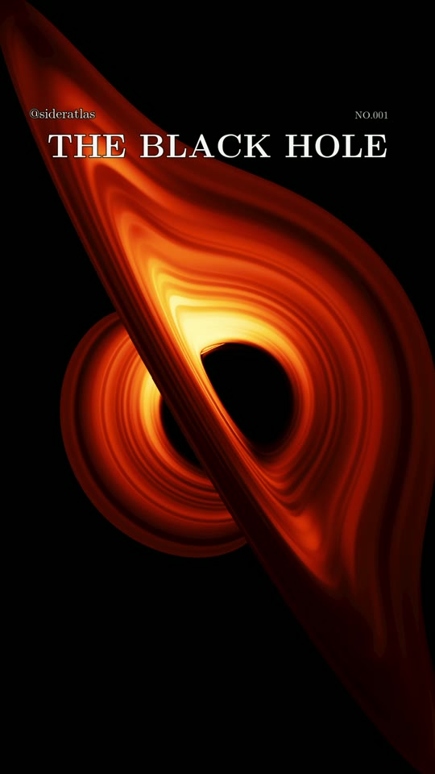
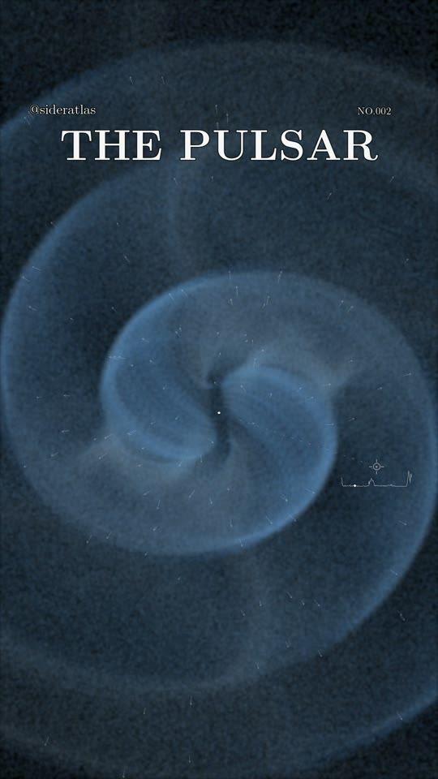
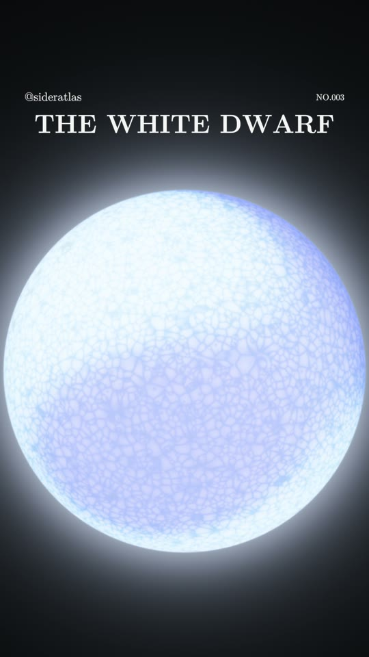
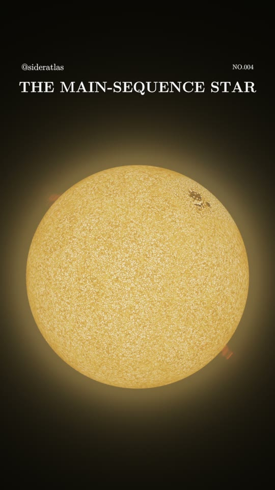
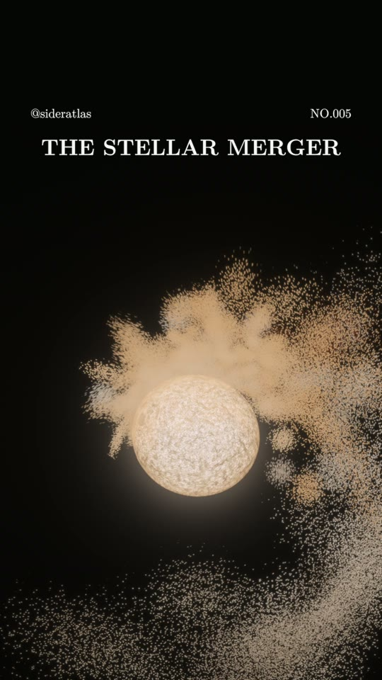
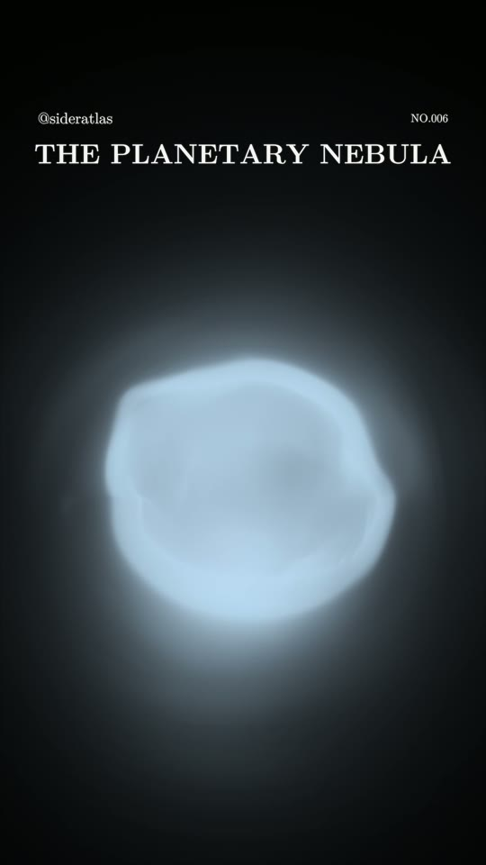
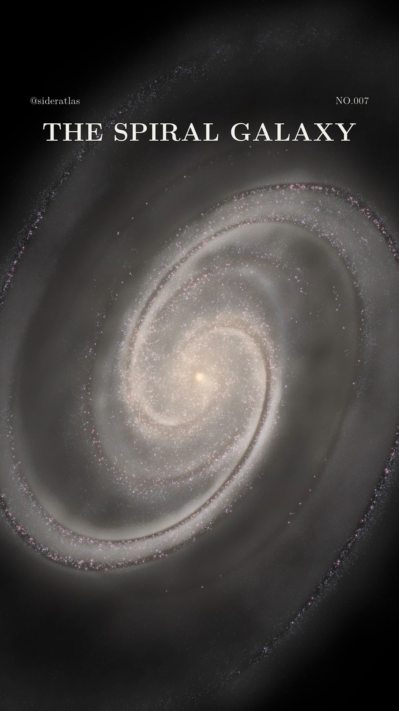

# SIDERATLAS

Numerical visualizations of astrophysical phenomena, combining physical models, scientific computation, and cinematic rendering.

Seven selected films · 32 seconds each · 1080 × 1920 · 30 fps

| **NO.001 — THE BLACK HOLE** | **NO.002 — THE PULSAR** | **NO.003 — THE WHITE DWARF** |
|---|---|---|
|  |  |  |
| Curved light paths around a hypothetical charged, spinning black hole. | Calculated gamma-ray directions and delayed pulses from an approximate pulsar model. | Six interior gravity modes and explicitly enhanced statistical granulation. |
| [Watch](https://github.com/Loganpis/sideratlas/releases/download/no001-v1.0.0/sideratlas-kerr-newman-reel.mp4) · [Source & science](episodes/001-black-hole) | [Watch](https://github.com/Loganpis/sideratlas/releases/download/no002-v1.0.0/sideratlas-002-pulsar-reel.mp4) · [Source & science](episodes/002-pulsar) | [Watch](https://github.com/Loganpis/sideratlas/releases/download/no003-v1.0.0/sideratlas-no003-the-white-dwarf-32s.mp4) · [Source & science](episodes/003-white-dwarf) |

| **NO.004 — THE MAIN-SEQUENCE STAR** | **NO.005 — THE STELLAR MERGER** | **NO.006 — THE PLANETARY NEBULA** |
|---|---|---|
|  |  |  |
| Published local solar radiation-MHD models on a rotating view of a sphere. | A prescribed inspiral with gravity-guided gas and approximate radiation. | A solar-mass evolutionary track, interacting winds and finite-photon ionization. |
| [Watch](https://github.com/Loganpis/sideratlas/releases/download/no004-v1.0.0/sideratlas-no004-golden-orbit-32s.mp4) · [Source & science](episodes/004-main-sequence-star) | [Watch](https://github.com/Loganpis/sideratlas/releases/download/no005-v1.0.0/sideratlas-no005-the-stellar-merger-1080x1920.mp4) · [Source & science](episodes/005-stellar-merger) | [Watch](https://github.com/Loganpis/sideratlas/releases/download/no006-v1.0.0/SiderAtlas-No006-The-Planetary-Nebula-GIANT-CELLS-1080x1920.mp4) · [Source & science](episodes/006-planetary-nebula) |

| **NO.007 — THE SPIRAL GALAXY** |
|---|
|  |
| Calculated stellar and gas responses to an externally prescribed spiral potential. |
| [Watch](https://github.com/Loganpis/sideratlas/releases/download/no007-v1.0.0/SiderAtlas-No007-The-Spiral-Galaxy-32s-1080x1920.mp4) · [Source & science](episodes/007-spiral-galaxy) |

The models have different levels of approximation. Each episode identifies calculated quantities, prescribed behavior, display enhancements and reproduction limits. These films are scientific visualizations, not telescope recordings.

[Verified exports](releases.json) · [Reproduction and validation](VALIDATION.md) · [Licensing](LICENSE)
