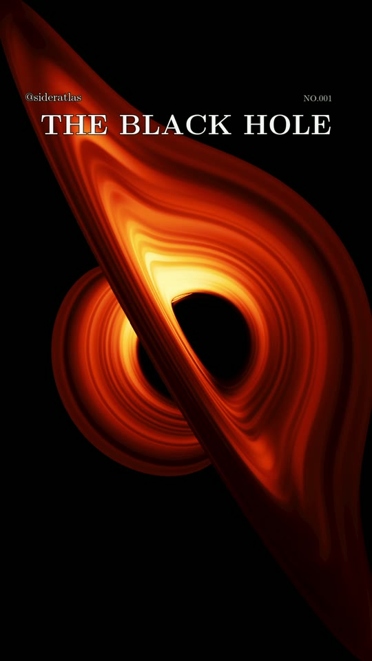

# NO.001 — THE BLACK HOLE

## Overview

Calculated light paths reveal multiple images of a thin accretion flow around a hypothetical Kerr–Newman black hole. The selected orange film uses the accepted centered title and diagonal composition.

## Watch

**[Watch the final 32-second animation](https://github.com/Loganpis/sideratlas/releases/download/no001-v1.0.0/sideratlas-kerr-newman-reel.mp4)** · [Release](https://github.com/Loganpis/sideratlas/releases/tag/no001-v1.0.0) · [Caption](caption.text)

<a href="https://github.com/Loganpis/sideratlas/releases/download/no001-v1.0.0/sideratlas-kerr-newman-reel.mp4"></a>

## Physics and methods

Spin a* = 0.9; dimensionless charge q = 0.4. Null geodesics calculate intersections, capture, frequency shifts and propagation delays. Neutral gas follows normalized orbital motion and an ISCO plunge. Page–Thorne supplies the exterior azimuthal mean. Bolometric transport uses I_obs = g⁴ I_em and t_em = t_obs − delay. One 800 GM/c³ cycle is displayed over eight seconds and repeated four times, with the selected viewpoint scan.

## Scientific limitations

Large charge is hypothetical. The aligned, neutral test disk is not GRMHD or a charge-evolution calculation. Radial drift, finite-lived emissivity patches, inner heating and opacity are prescribed. No mass, accretion rate or physical spectrum is assigned: orange encodes brightness, not true visible color. [MODEL.md](MODEL.md) maps the equations and each study’s role.

## Reproduction

Run from this episode directory with Python 3.12, a C++17 compiler and FFmpeg/FFprobe with libx264 and zscale:

```sh
python -m pip install -r requirements.txt
python render_kn_accretion.py
python generate_kn_steady_reference.py
python assemble_kn_accretion.py
python verify_kn_accretion.py
python review_kn_accretion_video.py
```

The C++ library is built from source locally. Raw radiance caches are generated, not kept in Git. Numerical limit checks and source preservation were checked for consolidation; the full ray trace/movie was not rerun. [validation.json](validation.json) preserves selected original evidence. Original code has no general reuse license; see [notices](THIRD-PARTY-NOTICES.md).

## References

[Kerr 1963](https://doi.org/10.1103/PhysRevLett.11.237), [Newman et al. 1965](https://doi.org/10.1063/1.1704351), [Page & Thorne 1974](https://doi.org/10.1086/152990), [Luminet 1979](https://ui.adsabs.harvard.edu/abs/1979A%26A....75..228L/abstract). Full applied bibliography: [MODEL.md](MODEL.md). NASA/Goddard/J. Schnittman 2019 is a motion reference; no NASA footage or code is used.

Exact export checksum, original source revision and selected-file hashes: [provenance.json](provenance.json). The central release tag selects the accepted export; it does not certify earlier development versions.
