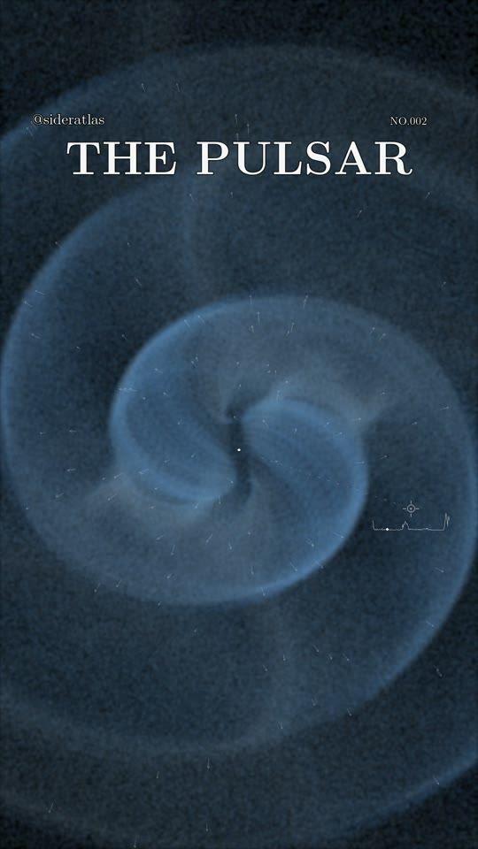

# NO.002 — THE PULSAR

## Overview

Calculated 0.1–100 GeV photons propagate away from a rotating pulsar and periodically reach a fixed distant observer. The blue pattern and white direction markers sample the same photon population.

## Watch

**[Watch the final 32-second animation](https://github.com/Loganpis/sideratlas/releases/download/no002-v1.0.0/sideratlas-002-pulsar-reel.mp4)** · [Release](https://github.com/Loganpis/sideratlas/releases/tag/no002-v1.0.0) · [Caption](instagram-description.text)

<a href="https://github.com/Loganpis/sideratlas/releases/download/no002-v1.0.0/sideratlas-002-pulsar-reel.mp4"></a>

## Physics and methods

A recorded 97³ numerical force-free field supports particle trajectories, prescribed acceleration, curvature radiation and delayed photon arrival. The saved display quadrature contains 12,288 weighted packets; directions remain fixed after emission. The physical period is 89.371 ms, displayed over eight seconds and repeated four times. The observer pulse uses the original conservative emission calculation, not the sparse display points.

## Scientific limitations

This is Vela-informed, not a quantitative Vela reconstruction. Pulse shape and spectrum disagree with measurements. The enlarged conductor, finite injection surface, supplied particles, acceleration and frozen rotating field are approximations. Gamma-ray colors and externally visible rays are diagrammatic false colors, not scattered visible light. [METHODS.md](METHODS.md) gives source roles and bounds.

## Reproduction

From this directory, with Python 3.12 and FFmpeg/libx264/zscale:

```sh
python -m pip install -e '.[test]'
python -m pytest -q tests physics/tests
python render_photon_reel.py
python verify_reel.py media
```

The small saved photon scene is included; rendering needs no field or particle solve. Its unused local-path metadata was made portable; every numerical array is identical to the selected scene. For the optional native calculation source, from the repository root:

```sh
python tools/fetch_inputs.py 002
cd episodes/002-pulsar
python physics/build_native_release.py curl-radiative --prepare-only
```

The separately supplied GPL upstream source plus four pinned patches preserve the selected calculation; compilation additionally needs CMake, MPI and parallel HDF5. The exact selected 97³ field is a checksum-pinned asset of the unified release. It is unnecessary for saved-scene rendering. Large original particle trace chunks were not distributed; rerunning that optional stage requires the preserved numerical calculation. See [inputs.json](inputs.json), [validation.json](validation.json), [GPL license](LICENSE) and [NOTICE](NOTICE).

## References

[Spitkovsky 2006](https://arxiv.org/abs/astro-ph/0603147), [Kalapotharakos et al. 2014](https://arxiv.org/abs/1310.3545), [Barnard et al. 2022](https://arxiv.org/abs/2111.03405), [Smith et al. 2023 / 3PC](https://arxiv.org/abs/2307.11132), [COFFEE](https://github.com/fizban007/CoffeeGPU). Full credits: [METHODS.md](METHODS.md).

Exact export checksum, original source revision and selected-file hashes: [provenance.json](provenance.json). The central release tag selects the accepted export; it does not certify earlier development versions.
