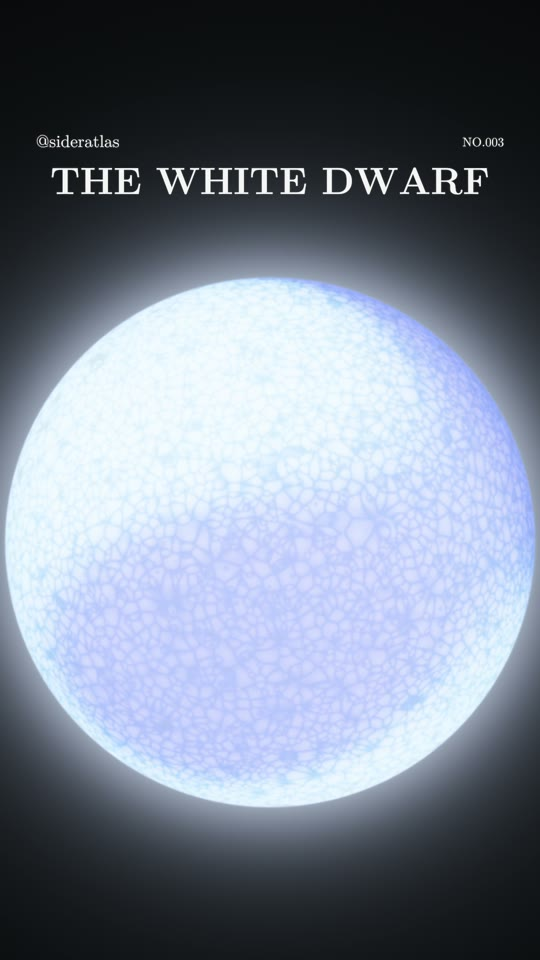

# NO.003 — THE WHITE DWARF

## Overview

A representative pulsating DA white dwarf shows six nonradial interior gravity modes, enhanced temperature interference patterns and a statistically constrained cellular surface under a slow camera scan.

## Watch

**[Watch the final 32-second animation](https://github.com/Loganpis/sideratlas/releases/download/no003-v1.0.0/sideratlas-no003-the-white-dwarf-32s.mp4)** · [Release](https://github.com/Loganpis/sideratlas/releases/tag/no003-v1.0.0) · [Caption](instagram-description.text)

<a href="https://github.com/Loganpis/sideratlas/releases/download/no003-v1.0.0/sideratlas-no003-the-white-dwarf-32s.mp4"></a>

## Physics and methods

The WDEC equilibrium has approximately 0.593 M☉, radius 9,018 km and Teff 11,290 K. Six adiabatic GYRE modes have distant-observer periods of about 247–488 s. Spherical harmonics, DA spectral integration, limb darkening and weak-field propagation determine the source radiation. A fixed observer remains separate from the moving camera.

## Scientific limitations

Excitation amplitudes, m values and phases are prescribed; no validated nonadiabatic driving or mode–convection coupling is claimed. Granulation is a finite-lived weighted-Voronoi statistical surrogate, not RHD, enlarged about 551×. Fixed ±160 K false colors, 4 K asinh softening, pulsation gain 2.7, cellular contrast 4 and halo display gain 6 enhance visibility. Mode time is accelerated 53.8× while convection is slowed 20×: these are separate visualization clocks. [METHODS.md](METHODS.md) gives the equations and data credits.

## Reproduction

Python 3.12 and FFmpeg/libx264/zscale are required. From the repository root, obtain the author-generated cellular catalog and the separately hosted atmosphere inputs:

```sh
python tools/fetch_inputs.py 003
cd episodes/003-white-dwarf
python -m pip install -r requirements-lock.txt
python v220/validate_cells.py
python v220/render_reel.py --workers 2
python v220/validate_reel.py
```

[inputs.json](inputs.json) pins each archive and extracted file. Atmosphere tables and integration caches are not newly redistributed here because provider rights are distinct from the MIT code license. Their existing source URLs and hashes are retained. Rendering uses saved eigenvalues/atmospheres; GYRE is not needed. A bounded saved-input frame and numerical checks were tested; the complete native movie was not rerendered for consolidation. Source, statistical and original export checks are in [validation.json](validation.json).

## References

[Bischoff-Kim & Montgomery 2018 / WDEC](https://doi.org/10.3847/1538-3881/aab70e), [Townsend & Teitler 2013 / GYRE](https://doi.org/10.1093/mnras/stt1533), [Koester 2010](https://arxiv.org/abs/0812.0482), [Claret et al. 2020](https://doi.org/10.1051/0004-6361/202038436), [Tremblay et al. 2013](https://arxiv.org/abs/1307.2810). Full software/data licenses and reference roles: [METHODS.md](METHODS.md), [LICENSE](LICENSE), [licenses](licenses).

Exact export checksum, original source revision and selected-file hashes: [provenance.json](provenance.json). The central release tag selects the accepted export; it does not certify earlier development versions.
