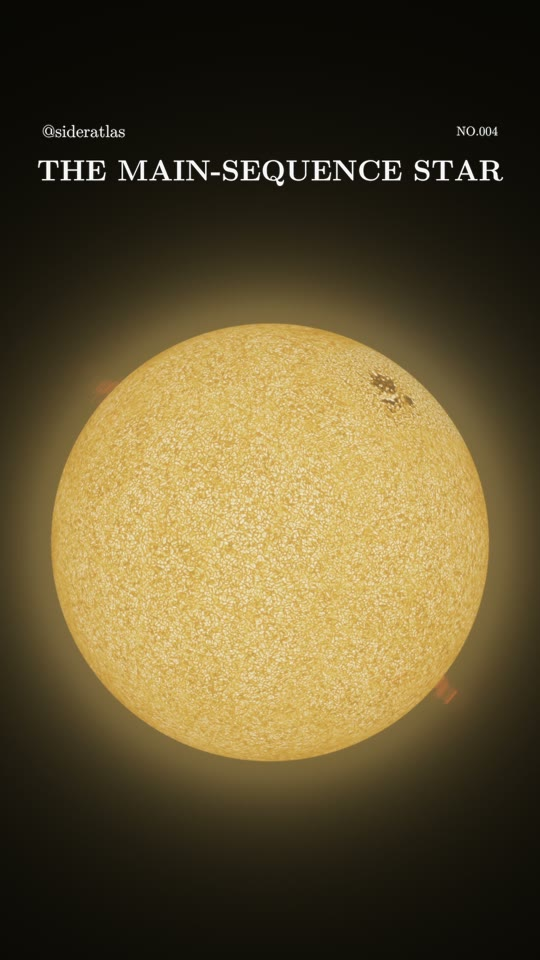

# NO.004 — THE MAIN-SEQUENCE STAR

## Overview

A golden Sun-like photosphere displays evolving granulation, a magnetic active region and a separately exposed ultraviolet atmosphere. The camera makes four complete orbits in 32 seconds.

## Watch

**[Watch the final 32-second animation](https://github.com/Loganpis/sideratlas/releases/download/no004-v1.0.0/sideratlas-no004-golden-orbit-32s.mp4)** · [Release](https://github.com/Loganpis/sideratlas/releases/tag/no004-v1.0.0) · [Caption](instagram-caption.text)

<a href="https://github.com/Loganpis/sideratlas/releases/download/no004-v1.0.0/sideratlas-no004-golden-orbit-32s.mp4"></a>

## Physics and methods

Representative parameters are 1 M☉, 1 R☉ and Teff 5,772 K. Local published Bifrost and MURaM radiation-MHD data provide photospheric variation and magnetic-region morphology. Continuum transfer, spectral integration and limb darkening supply radiation. The atmospheric channel uses CHIANTI C IV emissivity from a separate 2.5D source. The source advances continuously through 640 physical seconds; camera orbits take eight playback seconds each, distinct from the 25.38-day physical rotation prescription.

## Scientific limitations

This is an assembly of local models on a sphere, not a globally simulated MHD star. Spatial magnification, contrast and fixed golden grading are display choices. The UV component is a finite-depth reconstruction of 2.5D data, not calculated 3D jet populations or broadband visible spicules; it can appear sheet-like. Its false-color exposure has no calibrated optical-to-UV ratio. [METHODS.md](METHODS.md) documents all scales, clocks, radiation assumptions and attributions.

## Reproduction

Use Python 3.12, the pinned requirements and FFmpeg with libx264/zscale. From this directory:

```sh
python -m pip install -r requirements.txt
python reproduce_sources.py
NUMBA_NUM_THREADS=3 OPENBLAS_NUM_THREADS=1 python golden_orbit/validate.py
NUMBA_NUM_THREADS=3 OPENBLAS_NUM_THREADS=1 python golden_orbit/render.py --config config-final.json
python golden_orbit/validate_export.py
python golden_orbit/validate_orbits_export.py
```

Large institutional data and processed maps remain external. Reconstruction downloads several GB and performs continuum transfer; it does not rerun MHD. Source payload hashes and processed tolerances are pinned in the retained manifests. The final C IV coefficient table is supplied; original atomic source hashes are retained for audit. Provider availability and redistribution terms apply. Source/camera/color checks were verified, with original convergence/export evidence in [validation.json](validation.json); full data reconstruction/movie export was not repeated during consolidation. Original code is [MIT](LICENSE); data/fonts retain the terms in [METHODS.md](METHODS.md).

## References

[Gudiksen et al. 2011 / Bifrost](https://doi.org/10.1051/0004-6361/201116520), [Carlsson et al. 2016](https://doi.org/10.1051/0004-6361/201527226), [Cheung et al. 2019 / MURaM](https://doi.org/10.1038/s41550-018-0629-3), [Martínez-Sykora et al. 2017](https://doi.org/10.1126/science.aah5412), [CHIANTI](https://www.chiantidatabase.org/). MURaM dataset: CC BY 3.0, **Provided by the Stanford University Libraries**. Full source roles: [METHODS.md](METHODS.md).

Exact export checksum, original source revision and selected-file hashes: [provenance.json](provenance.json). The central release tag selects the accepted export; it does not certify earlier development versions.
