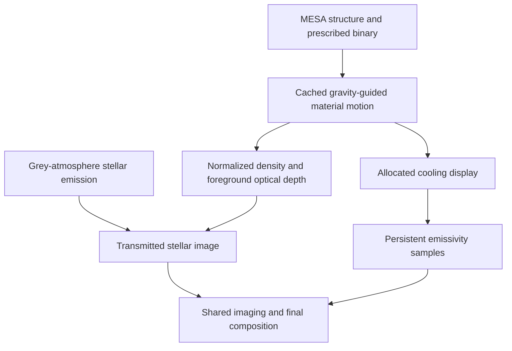

# Technical methods and attribution

Selected final-model documentation, consolidated without changing the methods.

---

# Physical model

This is a plausible, V1309 Sco–informed scenario. The prescribed binary history supplies a time-dependent gravitational environment for calculated gas motion. It is not a prediction that these initial conditions must merge.

## Stellar inputs

| Initial quantity | Evolved donor | Main-sequence companion |
|---|---:|---:|
| Mass | 1.52 M☉ | 0.16 M☉ |
| Radius | approximately 3.722 R☉ | approximately 0.178 R☉ |
| Effective temperature | approximately 5,019 K | approximately 3,527 K |

The donor's supplied MESA profile gives enclosed mass $M(<r)$. The companion uses MESA global parameters, with a finite uniform-sphere gravity prescription; it is not a resolved companion hydrodynamic structure. An additional finite central component represents prescribed disruption. MESA evolution is not rerun by the rendering workflow.

## Prescribed binary evolution

The separation follows the retained scenario law

$$a(t)=a_f+(a_0-a_f)(1-u^3)^{3/2},\qquad u=\mathrm{clip}(t/300,0,1)$$

with $a_0=7.2R_\odot$ and $a_f=0.25R_\odot$. The companion's surviving fraction is smoothly reduced near the end of this interval. A Kepler-like angular frequency in the adopted enclosed-mass potential supplies orbital phase. Remnant expansion is prescribed after coalescence. These choices are not a solved Darwin instability, hydrodynamic drag law or orbital backreaction calculation.

The exact numerical values are in [the model configuration](METHODS.md). Pressure-work source packets and their launch schedule are also prescribed, with a finite launch-energy allowance.

## Calculated gas transport

The model integrates inertial gas positions and velocities in the moving finite stellar potential:

$$\dot{\mathbf x}_i=\mathbf v_i,\qquad \dot{\mathbf v}_i=-\nabla\Phi(\mathbf x_i,t)$$

Launch velocities include translation of the donor, retained envelope rotation, and a prescribed pressure-work launch component. Parcels are not subsequently rotated as rigid arms attached to the binary. There are 8,192 source tracers representing a total launched allocation of 0.03 M☉; the live gas mass changes with sources and sinks.

Selected approaching pairs receive central inelastic impulses. Lost kinetic energy becomes internal energy under that closure. This is an approximate interaction prescription, not a resolved pressure field or shock front. Thermal energy subsequently cools on the adopted effective timescale.

The bookkeeping retains

$$M_1(t)+M_2(t)+M_{\rm gas}(t)=1.68M_\odot$$

and explicitly accounts for work in the changing external potential, sources, sinks and unresolved stellar angular-momentum reservoirs. A small accounting residual does not establish a self-consistent closed-binary evolution. [Final accounting checks](validation.json) state the measured residuals and their scope.

Positive instantaneous energy and outward radial motion identify **escape candidates**, not guaranteed asymptotic escape in a time-dependent potential. Returning material is classified using inward radial motion after a prior outward excursion.

## Emission and obscuration

Stellar colors use a Planck spectrum integrated against the CIE observer response. A grey LTE atmosphere supplies a formal intensity integral and limb darkening:

$$I_\nu(\mu)=\int_0^\infty B_\nu[T(\mu u)]e^{-u}\,du,\qquad T^4(\tau)=\tfrac34T_{\rm eff}^4(\tau+\tfrac23)$$

This is not a line-blanketed, non-LTE stellar atmosphere. The donor's thermal response, localized heating and expansion are reduced prescriptions constrained by the retained model reservoirs.

Foreground stellar extinction is

$$I_{\rm direct}=I_\star e^{-\tau},\qquad \tau=\int\kappa\rho\,ds,\qquad \kappa=0.1\ {\rm cm^2\,g^{-1}}$$

The reconstructed density sums normalized, compact Wendland C2 kernels:

$$\rho(\mathbf x)=\sum_i m_iK_i(\mathbf x-\mathbf x_i),\quad \int K_i\,d^3x=1,\quad C_{\rho,i}=0.4^2C_{{\rm material},i}$$

This preserves parent mass but does not make covering area independent of the unresolved-density assumption.

The visible gas is a **particle-sampled, unoccluded cooling-energy display**. It is not a calibrated optical flux or a solved reradiation source function. The rejected spherical reprocessed-light display remains absent. Absorbed stellar light is not reassigned to a new bright photosphere to reveal the hidden remnant.

See [limitations](METHODS.md), [methods](methods.md) and [references](METHODS.md).


---

# Numerical and rendering methods

## Retained calculation

The original corrected transport integrator is [scripts/integrate_model.py](METHODS.md). It uses the scenario and finite stellar gravity in [src/dynamics/prescribed.py](METHODS.md) and [src/gas_transport.py](METHODS.md). The rendering workflow uses its completed, checksum-identified caches instead of repeating the integration.

Interpolation is event-aware: births, deaths and impulsive encounters define separate trajectory intervals. Cached force-based quintic interpolation preserves continuous motion without smoothing through physical velocity impulses. The source and encounter records are part of the release input asset.

## Image construction



The gas display branch is unoccluded; the diagram does not imply a common self-consistent radiative-transfer calculation.

Each live parent has 512 immutable, positive-weighted emission labels. The labels are whitened and centered within the measured local material-neighborhood support. Their offsets deform with the existing covariance and translate with the exact-time parent trajectory. No independent random velocities, new gas forces or additional mass are introduced.

Cooling power is conservatively distributed among those samples. A compact quadratic B-spline raster footprint provides small-pixel antialiasing. Exposure integration follows actual source time; the exact 960-frame sample-count schedule is [config/exposure-samples.json](METHODS.md). The playback shutter is 1/60 s, not the physical exposure of an astronomical observation.

Stellar photospheric detail adapts the No.004 rendering infrastructure. Bifrost-derived normalized intensity topology and a separately credited MURaM active-region template are rethermalized and rescaled. This is **statistical morphology**, not calculated giant convection or donor magnetism. Selected visual prescriptions include 6× granulation spatial magnification, an assumed 18% bolometric RMS, enhanced display contrast, and a slowed convection clock. See [surface provenance](data/input-manifest.json).

Warm gas chromaticity is referenced to each parent's fixed launch spectrum and approximate thermal evolution. Colors are monotonic for a given source reference, but equal colors need not mean equal absolute temperatures for different parcels. The warmer grade, contrast, stellar optical halo and 0.5% gas bloom are imaging/visualization choices. They do not add luminosity to the retained physical source bookkeeping.

## Selected camera and time

The final film uses the previous production camera: 10° more polar than the earlier baseline, with smooth angular easing and a fixed **55 R☉ half-width after 24 s**. The star is not enlarged. Distant particles may leave the frame naturally.

Playback maps [0, 8, 16, 24, 32] s to model times [0, 140, 210, 300, 390] through a monotone PCHIP. One model time unit is approximately 1,592.86 s, so the film compresses approximately 7.19 days nonuniformly. This external camera clock is separate from the material dynamics.

## Export and verification

The renderer supplies 16-bit sRGB frames. The retained [video exporter](METHODS.md) converts them once to H.264 High, YUV420p, Rec.709 limited range, with FFmpeg zscale and explicit metadata. The published full-resolution MP4 is the exact selected export, not a rerender or recompressed copy.

The original all-frame, source-clock, clipping, mass/power and opacity checks are in [validation/final-checks](validation.json). Publication adds reduced-resolution reference-pixel parity and a clean-checkout smoke test. These checks do not establish hydrodynamic convergence. The native 32-second movie is not recomputed during packaging.

## Portability and curation

The mathematical implementation is reused. Three helper modules were relocated; old standalone preview entry points were omitted; paths are relative to the checkout. Unused base-atlas initialization was removed. The selected material-only renderer never reads the old control covariance, velocity or acceleration arrays, so their approximately 1.5 GB payload is omitted. The time and parent-ID arrays remain unchanged.

Some retained parent classes contain overridden compatibility methods. Only [src/rendering/final_scene.py](METHODS.md) is the supported scene entry point. A small archived radial-field cache remains an initialization dependency of those classes; its spherical emission is explicitly disabled and contributes zero displayed power. It must not be interpreted as a new emitting photosphere.

The original input profile and used numerical arrays retain their values. Descriptive path metadata is sanitized. [Source portability](validation.json) records origins and checksums; [reference-pixel parity](validation.json) checks the curated path against the selected original.


---

# What this visualization can and cannot claim

## Physical scope

- **The merger is prescribed.** This release does not calculate whether the binary is Darwin unstable or must merge. It does not solve tidal orbital evolution or hydrodynamic inspiral drag.
- Gas follows a time-dependent prescribed stellar potential. Gas self-gravity, resolved pressure, radiation-MHD and stellar response to the full gas forces are absent.
- Launch geometry, supply and pressure-work allowance are closures. Central restitution encounters approximate dissipation; they are not resolved fluid shocks.
- The companion is not a fully resolved fluid star. Its finite gravity and prescribed disruption cannot predict detailed companion survival or fragmentation.
- Source/sink and potential-work bookkeeping is essential, but does not turn the externally driven scenario into a closed, self-consistent binary.
- Positive instantaneous energy is not an invariant escape classification in the moving potential.

## Radiation and appearance

- Stellar spectra and limb darkening use an LTE grey atmosphere, not a comprehensive opacity, line or non-LTE calculation.
- Opacity is grey. Compact kernel shape, support width and unresolved covering area affect visibility. This density field has not been validated against merger hydrodynamics.
- The gas image is an **unoccluded cooling diagnostic**, not measured visible flux. Stellar transmission and gas display fractions are not bolometric escape fractions.
- Absorbed starlight is not self-consistently reradiated. No arbitrary luminous layer is added to make an obscured star visible.
- Surface granulation and activity are rescaled solar-derived morphology. They do not establish giant-star convection, magnetic spots or radiation-MHD. Statistical amplitudes, magnification and the separate surface clock are prescribed.
- Fine points represent unresolved emissivity samples. They do not resolve individual plasma particles, turbulence, instabilities or new stream filaments.
- Warm false colors, contrast and optical halos are disclosed enhancements. They are not absolute-temperature measurements or literal telescope imaging.
- The dim companion has its physical model scale; apparent absence may follow engulfment or opacity rather than a visibility adjustment.

## Reproduction limits

Re-rendering is supported from the retained caches **when every required input is available**. Two Bifrost-derived archives are not redistributed because explicit redistribution terms were not confirmed. The original derivation script, source provenance and required hashes are included, but raw-data-to-surface regeneration has not been repeated or validated for this release. A public clone with only the supplied release asset is therefore incomplete for image reproduction.

The clean-checkout check used locally restored, checksum-matching copies of those two maps. It tested three small frames, not a second full native film. Pinning Python packages improves repeatability; different numerical libraries, hardware and FFmpeg builds may still produce different image/encoding bits. The released MP4 itself is checksum-identified.

The corrected gas integrator is supplied for inspection and optional regeneration. Rebuilding the entire cache chain from a new integration, and rerunning MESA evolution, are outside the tested release workflow. Supplied caches preserve the completed selected calculations.

## Earlier StarSmasher work

Earlier development investigated stellar initialization and SPH donor stability. Some research gates remained unsatisfied, and development subsequently adopted the reduced-order approach. Those tests are not presented as accepted binary-merger simulations. StarSmasher did not generate the final gas trajectories. Its source, binaries, checkpoints and failed development campaign are intentionally absent from this focused release.


---

# References and their roles

## Merger scenario and outflows

- **Nandez, Ivanova & Lombardi (2014), [V1309 Sco — Understanding a merger](https://doi.org/10.1088/0004-637X/786/1/39).** Informs the representative 1.52 + 0.16 M☉ system and the broad merger/ejection context. The paper's StarSmasher calculations are not this release's trajectories, initial conditions or validated outcome.
- **MacLeod, Ostriker & Stone (2018a), [Runaway Coalescence at the Onset of Common Envelope Episodes](https://doi.org/10.3847/1538-4357/aacf08).** Guides the transition from trailing mass loss to broader outflow as the orbit tightens. This model does not reproduce its resolved hydrodynamics.
- **MacLeod, Ostriker & Stone (2018b), [Bound Outflows, Unbound Ejecta, and the Shaping of Bipolar Remnants during Stellar Coalescence](https://doi.org/10.3847/1538-4357/aae9eb).** Motivates distinguishing bound material, later ejecta and interactions. Resolved shock redirection and a predicted bipolar remnant are not claimed here.
- **Hubová & Pejcha (2019), [Kinematics of Mass Loss from the Outer Lagrange Point L2](https://doi.org/10.1093/mnras/stz2208).** Informs sensitivity to launch position and velocity and the distinction between escape candidates and fallback.
- **Pejcha, Metzger & Tomida (2016), [Binary Stellar Mergers with Marginally-Bound Ejecta](https://arxiv.org/abs/1604.07414).** Context for cooling and outflow regimes; not a calibration of this grey closure.
- **Matsumoto & Metzger (2022), [Light Curve Model for Luminous Red Novae and Inferences about the Ejecta of Stellar Mergers](https://arxiv.org/abs/2202.10478).** Context for radiation and expanding merger ejecta. The final display does not solve those radiation-hydrodynamic models.

## Stellar models, atmosphere and imaging

- **[MESA](https://docs.mesastar.org/)**, release 26.4.1, source revision `c8c202662922a22b3efefa824473ad615c623afd`. Previously computed one-dimensional stellar input, not rerun by this release. MESA source/toolchains are not redistributed.
- **Dehnen & Aly (2012), [Improving convergence in smoothed particle hydrodynamics simulations without pairing instability](https://doi.org/10.1111/j.1365-2966.2012.21439.x).** Context for normalized compact Wendland kernels. Use as a post-processing density kernel does not establish SPH convergence or hydrodynamic accuracy.
- **Gudiksen et al. (2011), [The stellar atmosphere simulation code Bifrost](https://doi.org/10.1051/0004-6361/201116520)** and **Carlsson et al. (2016), [A publicly available simulation of an enhanced network region of the Sun](https://doi.org/10.1051/0004-6361/201527226)**. Source context for solar-derived normalized morphology; no giant RHD simulation is claimed. The two derived surface arrays are not redistributed here.
- **Cheung et al. (2019; online 2018), [A comprehensive three-dimensional radiative magnetohydrodynamic simulation of a solar flare](https://doi.org/10.1038/s41550-018-0629-3)**, [Stanford dataset](https://purl.stanford.edu/dv883vb9686), CC BY 3.0. Supplies the normalized illustrative active-region intensity template, not calculated donor magnetism. **Provided by the Stanford University Libraries.** Full credit and modification details: [third-party notices](LICENSE).
- **CIE (2019), [CIE 1931 2° standard observer](https://doi.org/10.25039/CIE.DS.xvudnb9b)**, CC BY-SA 4.0. Unmodified spectral response table; [metadata](data/input-manifest.json).
- **[Latin Modern / GUST](https://www.gust.org.pl/projects/e-foundry/latin-modern)**. Fonts under the retained [GUST Font License](LICENSE).
- **[SiderAtlas No.004](https://github.com/Loganpis/sideratlas-main-sequence-star)**. Reused spherical sampling, spectral grading, optical imaging and export infrastructure under its retained [MIT notice](LICENSE).

No cited study's merger footage or numerical merger snapshots are substituted for calculated trajectories. Citations do not imply author endorsement.


---

# Reproduction: exact status and commands

## What is available

The release supplies the actual selected rendering implementation, corrected transport integrator, MESA donor profile/global stellar inputs, exact production settings, exposure sample counts, used cached material/thermal arrays, and final checks. No research-grade SPH run is required.

The large **render-inputs.zip** asset contains permitted numerical inputs, outside Git history. [The input manifest](data/input-manifest.json) identifies every required file by SHA-256 and distribution status. **morphology.npz and mesoscales.npz are external inputs and are not in that asset.** The final MP4 can be watched and verified without them.

## Environment

The original tested environment is Python 3.12.2, NumPy 1.26.4, SciPy 1.13.1, Numba 0.59.1 and Pillow 10.3.0. FFmpeg and FFprobe must provide libx264 and zscale; the original export used FFmpeg 8.0.

```sh
git clone https://github.com/Loganpis/sideratlas-no005-stellar-merger.git
cd sideratlas-no005-stellar-merger
python3.12 -m venv .venv
source .venv/bin/activate
python -m pip install -r requirements.txt
python scripts/fetch_inputs.py
python scripts/analyze_trajectories.py
```

The trajectory-analysis command uses only the publicly supplied numerical inputs and works without either external surface map. It reports cached live masses and instantaneous classifications, not a new integration.

The downloader validates the release-archive checksum and restores only relative paths. Offline, download render-inputs.zip from v1.0.0 and use `python scripts/fetch_inputs.py --archive /path/to/render-inputs.zip`.

## The two external surface maps

Explicit redistribution terms were not confirmed for the Bifrost-derived maps. They are not relicensed as MIT and are not silently replaced by a different texture.

If you already hold the original project inputs, the following restores only checksum-matching copies:

```sh
python scripts/fetch_inputs.py --archive /path/to/render-inputs.zip \
  --local-surface-source /path/to/original-project
```

Otherwise, [the original derivation recipe](data/input-manifest.json) expects a No.004 working tree with the calculated `data/continuum/*-17-2-solar.npz` sequence, matching sidecar JSON files, and `data/active-region/intensity-sequence.npz`. [Source provenance](data/input-manifest.json) records all 40 source-map names, hashes and times.

```sh
python scripts/derive_surface_inputs.py --source /path/to/no004-working-tree
python scripts/verify_inputs.py
```

Upstream atmosphere data are published through the [Oslo Bifrost archive](https://sdc.uio.no/vol/simulations/en024048_hion/atmos/), described by [Carlsson et al.](https://doi.org/10.1051/0004-6361/201527226). No.004's [public source-reproduction workflow](https://github.com/Loganpis/sideratlas-main-sequence-star/blob/main/reproduce_sources.py) describes its continuum calculation. Its release movie/source ZIP alone does **not** contain all required calculated maps. Obtaining those original intensities and their applicable reuse rights is an additional requirement.

**This raw-data regeneration route was not rerun or validated for No.005's publication.** The exact two maps are not available as a complete new public download here. Regenerating equivalent arrays does not guarantee byte-identical compressed archives; the supplied manifest identifies the actual selected inputs. Accordingly, this release does not claim complete public, from-scratch or one-command image reproducibility.

## Verify and render once all inputs are present

```sh
python scripts/verify_inputs.py
python scripts/smoke_test.py
python scripts/render.py --width 144 --start 14 --end 14.2 --output output/test.mp4
python scripts/render.py --output output/reel.mp4
```

The default is the exact selected 32-second timeline, native 1080 × 1920 and 30 fps. Sampling follows the saved production schedule. No optional camera, opacity or color alternative is selected. Existing renders are not overwritten.

The small smoke test is suitable for checking installation and accounting. A full native re-render is much more expensive and may take hours. It was not repeated for publication. The source profile, active numerical arrays and selected camera/emission configuration are preserved, but cross-platform bit-identical movie encoding is not promised.

## Inspect or regenerate the reduced transport

```sh
python scripts/integrate_model.py --config config/model.json --output output/regenerated-transport
```

This is the original corrected reduced-order integrator, not StarSmasher. It is optional and computationally expensive. It does not regenerate every derived rendering support automatically. The tested cached workflow uses the provided support, acceleration, launch-color and compatibility fields. Full cache-chain regeneration and new MESA evolution were not revalidated in this release.

## Verify the finished movie

Download the full-resolution MP4 from v1.0.0, then run:

```sh
python scripts/verify_video.py /path/to/sideratlas-no005-the-stellar-merger-1080x1920.mp4
```

Its SHA-256 is `6db42a007498ac97b1081bd3f0027ab7ac7fa1b4a0b87e740cf5f03ff87319d5`. This identifies the selected existing export. A 540 × 960 excerpt in media/preview.mp4 is only a browsing preview, not an alternate model or the native final asset.


---

# Source map

The public entry point selects one scene; the original numerical implementation is retained rather than replaced by another simulation.

| Location | Role |
|---|---|
| [src/rendering/final_scene.py](METHODS.md) | Supported final-scene factory and selected-setting guards |
| [src/detail/polar_final.py](METHODS.md) | Selected camera and compact-density foreground integration |
| [src/detail/material_geometry.py](METHODS.md) | Persistent weighted emissivity labels in material support |
| [src/detail/particle_cooling.py](METHODS.md) | Particle-only cooling display and exposure integration |
| [src/detail/remnant_focus.py](METHODS.md) | Retained late 55-R☉ camera scale and launch-relative thermal colors |
| [src/detail/wendland_c2.py](METHODS.md) | Normalized compact density and column quadrature |
| [src/motion_view.py](METHODS.md) | Event-aware cached states and force-based interpolation |
| [src/dynamics/prescribed.py](METHODS.md), [src/gas_transport.py](METHODS.md) | Prescribed binary state, finite stellar gravity and approximate encounters |
| [src/radiation/spectrum.py](METHODS.md), [src/quality/renderer.py](METHODS.md) | Spectral response, atmosphere, stellar surface and limb darkening |
| [src/stellar_render_reuse.py](METHODS.md), [src/video_export.py](METHODS.md) | Shared No.004-derived imaging and high-depth video export |
| [scripts](METHODS.md) | Cached trajectory analysis, rendering, input restoration, verification and optional original transport integration |
| [config](METHODS.md) | One final display configuration, numerical model and exact per-frame exposure schedule |
| [data](data/input-manifest.json) | Compact stellar/spectral inputs, attribution and large-input manifests |

Internal parent classes are not separate supported preview editions. Some compatibility methods remain overridden in the selected inheritance path. No obsolete preview CLI, SPH solver, research environment or failed stellar checkpoint is shipped.

