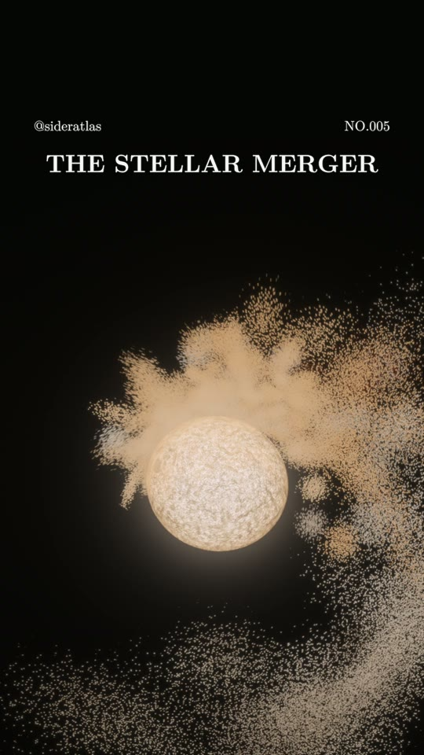

# NO.005 — THE STELLAR MERGER

## Overview

An evolved 1.52 M☉ donor interacts with a dim 0.16 M☉ companion, feeding asymmetric outflows before prescribed engulfment and coalescence. This is a reduced-order, physics-informed visualization, not a validated three-dimensional hydrodynamic merger prediction.

## Watch

**[Watch the final 32-second animation](https://github.com/Loganpis/sideratlas/releases/download/no005-v1.0.0/sideratlas-no005-the-stellar-merger-1080x1920.mp4)** · [Release](https://github.com/Loganpis/sideratlas/releases/tag/no005-v1.0.0) · [Caption](instagram-caption.text)

<a href="https://github.com/Loganpis/sideratlas/releases/download/no005-v1.0.0/sideratlas-no005-the-stellar-merger-1080x1920.mp4"></a>

## Physics and methods

Previously calculated MESA structures constrain stellar dimensions. Gas parcels follow moving gravitational sources with inertial launches, approximate dissipative encounters and thermal evolution. The inspiral, supply, disruption and remnant response are prescribed. Budgets explicitly retain source/sink terms and work from the time-dependent potential. MATERIAL ONLY displays persistent samples of unresolved cooling emissivity; continuous density still supplies foreground stellar extinction. The selected distant aftermath camera is retained.

## Scientific limitations

The merger outcome is prescribed, not discovered by an unforced orbit. No research-grade StarSmasher output produced the final gas motion. Density, pressure work, shocks, opacity and radiation are approximate closures; the display is not a self-consistent radiation-transfer solution. Gas cooling emission is unoccluded in the selected visualization while the stellar source retains foreground attenuation. Solar-derived giant surface morphology, warm grading, micro-emitter sampling and compressed time are disclosed enhancements. [METHODS.md](METHODS.md) gives full accounting and limitations.

## Reproduction

Use Python 3.12 and FFmpeg/libx264/zscale. From this directory:

```sh
python -m pip install -r requirements.txt
python scripts/fetch_inputs.py
python scripts/analyze_trajectories.py
# Supply or regenerate the two external Bifrost-derived surface inputs
python scripts/verify_inputs.py
python scripts/smoke_test.py
python scripts/render.py
```

The permitted 580 MB [cached-input archive](https://github.com/Loganpis/sideratlas/releases/download/no005-v1.0.0/render-inputs.zip) is attached to the selected unified release. It omits two surface archives whose redistribution rights were not confirmed. Their hashes and derivation are preserved in [data/input-manifest.json](data/input-manifest.json) and [METHODS.md](METHODS.md). **A public clone alone cannot render the complete image.** MESA/StarSmasher are unnecessary for the cached workflow. Original portability and clean-wheel tests passed at three epochs; the full movie was not rerendered for consolidation. See [validation.json](validation.json), [MIT license](LICENSE) and [third-party notices](THIRD-PARTY-NOTICES.md).

## References

[Nandez et al. 2014](https://doi.org/10.1088/0004-637X/786/1/39), [MacLeod et al. 2018a](https://doi.org/10.3847/1538-4357/aacf08), [MacLeod et al. 2018b](https://doi.org/10.3847/1538-4357/aae9eb), [Hubová & Pejcha 2019](https://doi.org/10.1093/mnras/stz2208), [Matsumoto & Metzger 2022](https://arxiv.org/abs/2202.10478). They guide approximate prescriptions; their simulations/footage were not used as this trajectory. Full roles and surface attribution: [METHODS.md](METHODS.md).

Exact export checksum, original source revision and selected-file hashes: [provenance.json](provenance.json). The central release tag selects the accepted export; it does not certify earlier development versions.
