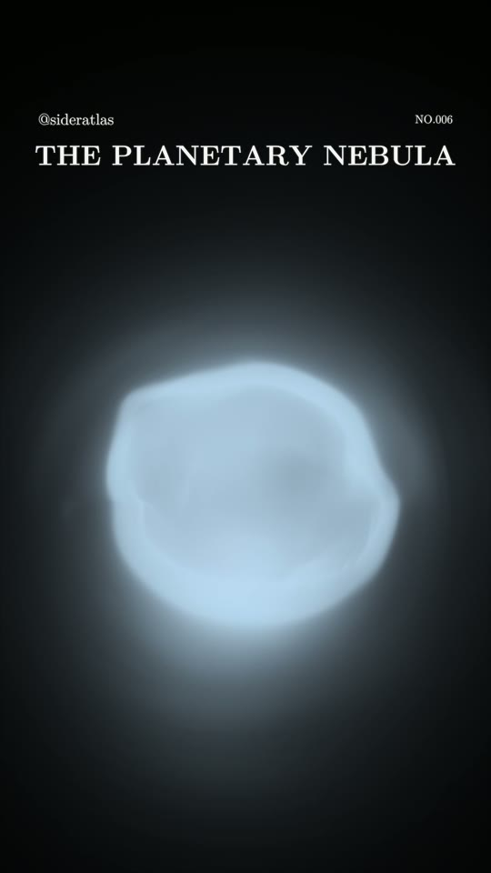

# NO.006 — THE PLANETARY NEBULA

## Overview

A published 1 M☉ evolutionary track connects a Sun-like star, giant/AGB envelope loss and a hot compact remnant surrounded by a faint, expanding ionized nebula. This is the accepted GIANT CELLS publication export, including the radius-continuity repair.

## Watch

**[Watch the final 32-second animation](https://github.com/Loganpis/sideratlas/releases/download/no006-v1.0.0/SiderAtlas-No006-The-Planetary-Nebula-GIANT-CELLS-1080x1920.mp4)** · [Release](https://github.com/Loganpis/sideratlas/releases/tag/no006-v1.0.0) · [Caption](caption.text)

<a href="https://github.com/Loganpis/sideratlas/releases/download/no006-v1.0.0/SiderAtlas-No006-The-Planetary-Nebula-GIANT-CELLS-1080x1920.mp4"></a>

## Physics and methods

MIST/MESA supplies age, mass, luminosity, radius and temperature, ending near 0.540 M☉. Conservative radial-sector winds approximate slow/fast-wind interaction. A finite-photon hydrogen history includes attenuation and recombination; oxygen/nitrogen ionization is approximate. PyNeb-generated tables supply Hα, Hβ, [O III] and [N II] emissivities. No.004 supplies the solar opening; applicable No.003 spectral/optical routines receive new hot-star inputs. Statistical giant cells satisfy the full-sphere bolometric temperature normalization. Physical age advances monotonically with strongly nonuniform playback compression.

## Scientific limitations

This is not a full 3D radiation-hydrodynamic nebula or a guaranteed prediction of the Sun’s observable nebula. Sector coupling, mass-loss geometry, dust, metal ionization and 10,000 K ionized gas are approximate. Giant cells are statistical, with scale floors, representative clocks and flagged low-gravity fit extrapolation; they are not tracked convective fluid. Planck/grey spectra, display gain, optical halo, infrared dust presentation and emission-line colors are disclosed. The accepted nebula is comparatively smooth; rejected filament/morphology experiments are excluded. [METHODS.md](METHODS.md) explains the boundaries.

## Reproduction

Use Python 3.12 and a qualified Apple-silicon/Metal environment, plus FFmpeg/libx264/zscale. From the repository root:

```sh
python tools/fetch_inputs.py 006
# Reconstruct/supply the byte-matched No.004 processed data using episode 004
python tools/fetch_inputs.py 006 --check
cd episodes/006-planetary-nebula
python -m pip install -r requirements.txt
mkdir -p native/build
swiftc -O -module-cache-path cache/swift-modules native/projector.swift -o native/build/projector
python qualify_projector.py
python render.py --start 0 --stop 960 --output output/final.mp4
```

The two selected numerical histories are a separate 115 MB release asset; the MIST track and atomic rate tables are fetched from their providers. All paths/hashes are in [inputs.json](inputs.json). The preflight fails on missing or changed inputs and never regenerates physical caches. The compiled projector is excluded from Git: a new OS/compiler/GPU build requires qualification against the CPU reference before claiming equivalent pixels. Full native regeneration is not independently verified across environments. The exact accepted video is authoritative. [validation](validation) retains original CPU/GPU, source, flux, encoded-video and continuity evidence. The six-second step is −0.751 px rather than the rejected approximately −144 px rollback. [MIT license](LICENSE); separate provider rights: [third-party notices](THIRD-PARTY-NOTICES.md).

## References

[Choi et al. 2016 / MIST](https://arxiv.org/abs/1604.08592), [Dotter 2016](https://arxiv.org/abs/1601.05144), [Gesicki et al. 2018](https://doi.org/10.1038/s41550-018-0453-9), [Kwok et al. 1978](https://adsabs.harvard.edu/pdf/1978ApJ...219L.125K), [Luridiana et al. 2015 / PyNeb](https://doi.org/10.1051/0004-6361/201323152), [Tremblay et al. 2013](https://arxiv.org/abs/1307.2810). All attribution, numerical source roles and limits: [METHODS.md](METHODS.md).

Exact export checksum, original source revision and selected-file hashes: [provenance.json](provenance.json). The central release tag selects the accepted export; it does not certify earlier development versions.
