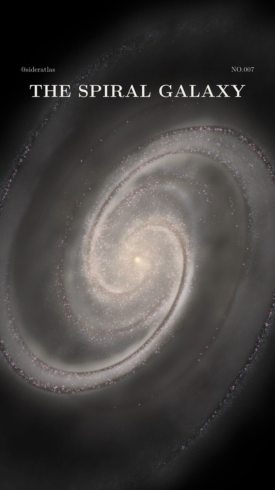

# NO.007 — THE SPIRAL GALAXY

An idealized galaxy reveals the different motions of stars, gas and a rotating spiral pattern. Calculated orbits, gas compression, young populations and dust produce the evolving image over 160 million years.

## Watch

**[Watch the final 32-second animation](https://github.com/Loganpis/sideratlas/releases/download/no007-v1.0.0/SiderAtlas-No007-The-Spiral-Galaxy-32s-1080x1920.mp4)** · [Release](https://github.com/Loganpis/sideratlas/releases/tag/no007-v1.0.0)

<a href="https://github.com/Loganpis/sideratlas/releases/download/no007-v1.0.0/SiderAtlas-No007-The-Spiral-Galaxy-32s-1080x1920.mp4"></a>

## Physical model

The selected `trailing22` calculation uses 100,000 statistical stellar samples in a prescribed Miyamoto–Nagai disk, Hernquist bulge and NFW halo. At 8.5 kpc, the model circular speed is 187.1 km/s; the halo contributes 132.1 km/s in quadrature, approximately 49.8% of v². These are model quantities, not an observed rotation-curve fit.

The trailing two-arm perturbation has primary pattern speed **22 km s⁻¹ kpc⁻¹** and pitch magnitude **24°**, with its retained harmonics and weaker independent three-arm term. Three-dimensional stellar orbits respond to the full time-dependent potential. Conservative two-dimensional gas transport uses 512² cells across 36 kpc, 70.31 pc cells and a 4 km/s effective isothermal sound speed. A solar-metallicity KMT shielding approximation and 1.5 Gyr molecular depletion time set the gas sink; newborn associations inherit calculated gas velocities through conservative source weights.

Approximate IMF-integrated Planck spectra, analytic lifetimes and prescribed giant contributions supply stellar light. Finite-height dust extinction uses the CCM Rᵥ=3.1 law. Hα/Hβ emission is limited by both ionizing photons and the available shared gas mass, using 10,000 K Case-B coefficients. The film shows **560–720 Myr in 32 seconds**, at 5 Myr per playback second; the inspection camera has an independent clock. Exact parameters and optical settings: [config.json](config.json).

## Scientific limitations

The spiral field is externally prescribed. This is not a live, self-gravitating galaxy, a reconstruction of M74, or a telescope observation. The simplified interstellar medium omits molecular-cloud collapse, feedback, magnetic fields and realistic multiphase turbulence. The initial single-component Q proxy is about 0.675, so omitted collective gravity may matter. Smooth inner gas-compression/dust arcs are a limitation of the accepted model.

Populations, ionization and broadband transfer are approximate; dust in-scattering and infrared reradiation are omitted. Points sample unresolved existing light rather than individual stars. D65 photographic adaptation, bounded local contrast, the optical halo and fourfold displayed hydrogen-line contrast are display conventions. They do not increase physical source luminosities or photon budgets.

## Reproduction

Use Python 3.12, [requirements.txt](requirements.txt), and FFmpeg/FFprobe with libx264 and zscale. From this episode directory:

```sh
python -m pip install -r requirements.txt
python -m src.populations  # inexpensive check of the included optical lookup
# Expensive, optional: regenerate only the selected physical calculation
OPENBLAS_NUM_THREADS=1 OMP_NUM_THREADS=1 python -m src.simulate --output work/calculation
# Render only when the numerical run passes its conservation checks
OPENBLAS_NUM_THREADS=1 OMP_NUM_THREADS=1 NUMBA_NUM_THREADS=4 python -m src.render --run work/calculation --output work/spiral-galaxy.mp4
```

The small accepted optical lookup and hydrogen coefficient subset are included. The several-gigabyte trajectory/gas histories are **not distributed**. The included source can regenerate the selected calculation; the original run took about 24 minutes on the development Mac, but present runtime and cross-platform bitwise equality are not guaranteed. Exact production replay requires the original saved realization and matching numerical/encoder environment. Rebuilding those histories and rerendering the movie from a clean checkout was **not** performed for publication. The supplied MP4 is the authoritative accepted export.

Publication checks preserve 40 numerical callable bodies and the full integration loop; small force, lookup, native initialization, camera and cached-history comparisons pass. The actual video has 960 frames, correct timestamps and continuous section joins. The original strict central any-channel ceiling check remains failed at 1.352% versus 1%; the user explicitly accepted its cream-colored gamut-normalization origin. No other failed check was waived. Essential results: [central validation](../../validation.json), [source provenance](provenance.json).

## References and licensing

[Miyamoto & Nagai 1975](https://doi.org/10.1093/pasj/27.4.533), [Hernquist 1990](https://adsabs.harvard.edu/pdf/1990ApJ...356..359H), [Navarro, Frenk & White 1997](https://arxiv.org/abs/astro-ph/9611107), [Cox & Gómez 2002](https://arxiv.org/abs/astro-ph/0207635), [Dobbs & Baba 2014](https://arxiv.org/abs/1407.5062), [Krumholz, McKee & Tumlinson 2009](https://arxiv.org/abs/0904.0009), [Kroupa 2001](https://arxiv.org/abs/astro-ph/0009005), [Cardelli, Clayton & Mathis 1989](https://doi.org/10.1086/167900), [Storey & Hummer 1995](https://doi.org/10.1093/mnras/272.1.41), [Luridiana et al. 2015 / PyNeb](https://doi.org/10.1051/0004-6361/201323152).

Original software/documentation: [MIT](LICENSE). The shared encoder is unchanged. Latin Modern fonts retain [GUST/LPPL notices](../../shared/fonts/GUST-FONT-LICENSE.txt). Unmodified [CIE 1931 data](https://doi.org/10.25039/CIE.DS.xvudnb9b) retain CC BY-SA 4.0 attribution and metadata. The hydrogen table contains numerical results generated with PyNeb 1.1.32 from Storey–Hummer input; its [provenance](data/atomic/pyneb-v3.json) is separate from the software license. PyNeb's GPLv3 software is not bundled. Movies/thumbnails receive no new blanket license. No paper figures, galaxy photographs or telescope textures are included.
